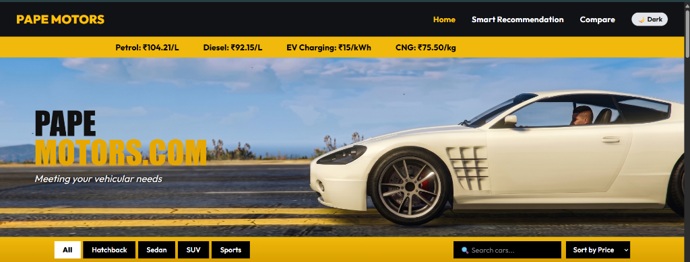
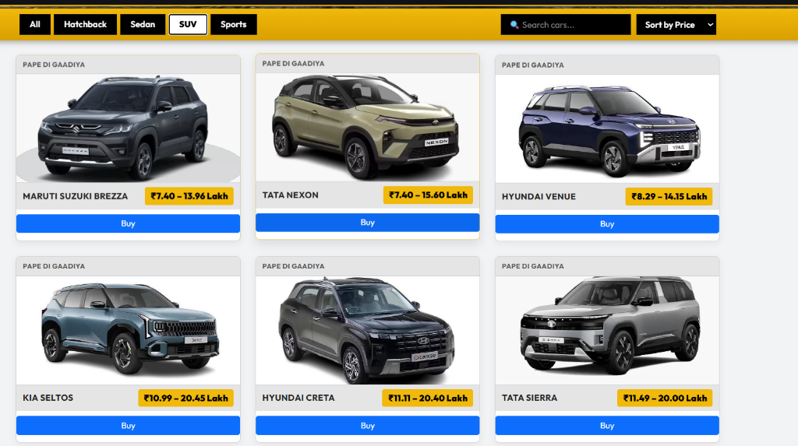
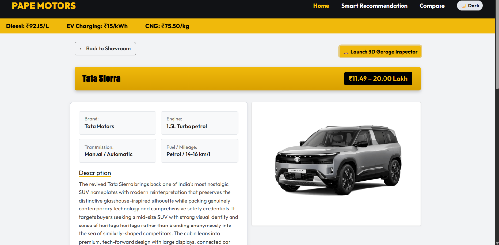
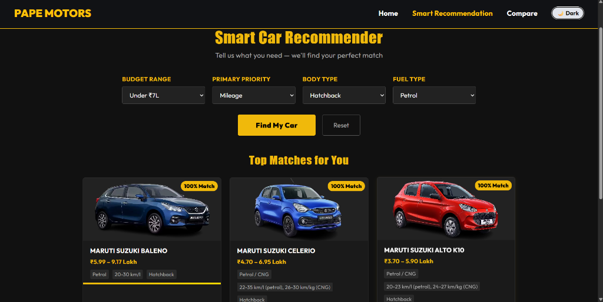
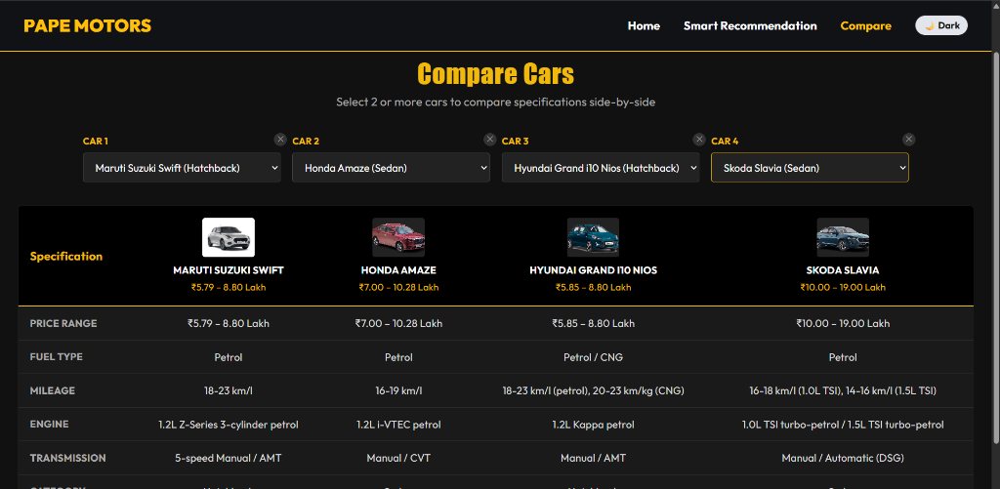

# 🏎️ Pape Motors — GTA V Style Dealership & Showroom Platform

[](https://react.dev/)
[](https://threejs.org/)
[](https://vitejs.dev/)
[](https://nodejs.org/)
[](https://getbootstrap.com/)
[](https://opensource.org/licenses/MIT)

> An authentic **GTA V Legendary Motorsport** inspired interactive web experience. Features real-time vehicle inventories, interactive 3D WebGL garage inspections, smart recommendation algorithms, side-by-side spec comparison matrix, and simulated dealership checkout flows.

---

## 📸 Visual Showcase

### 1. Showroom & Live Stock Browser
*Full-width gold action bar with category tabs (Hatchback, Sedan, SUV, Sports), real-time search, sorting engine, and instant checkout triggers.*



---

### 2. 🕹️ Interactive 3D Garage Inspector
*Inspect vehicle chassis in full 3D with interactive OrbitControls (360° rotation & scroll zoom) powered by `@react-three/fiber`.*


---

### 3. 🎯 Smart Vehicle Recommender
*Algorithm-driven matching engine filtering across budget tier, primary driving priorities (mileage, performance, safety), body configuration, and fuel choices.*


---

### 4. ⚖️ Multi-Vehicle Comparison Matrix
*Side-by-side technical breakdown across engine displacement, transmission systems, fuel efficiency, pricing, and key features.*


---

## ⚡ Core Features & Technical Highlights

- **GTA V Showroom Aesthetics**:
  - Iconic black & gold typography (`Impact` & Google Font `Outfit`).
  - Animated live fuel price ticker marquee.
  - Seamless dark and light theme system powered by React `ThemeContext` & custom CSS design tokens.
- **Interactive 3D WebGL Showroom**:
  - Integrated `@react-three/fiber` & `@react-three/drei` Canvas with procedural 3D sports chassis, lighting, and showroom turntable floor.
- **Dealership Checkout System**:
  - Modal checkout flow with Maze Bank wire transfer, Fleeca debit, and Los Santos crypto tokens.
- **Zero-Latency In-Memory Database Engine**:
  - High-performance Express backend with instant in-memory car inventory seeding (no external binary dependencies required).

---

## 🏗️ Architecture & Component Hierarchy

```text
pape-motors/
├── server/
│   ├── models/            # Mongoose schemas
│   ├── seedData.js        # Complete vehicle specs & database
│   └── server.js          # Express in-memory REST API
├── src/
│   ├── components/
│   │   ├── Car3DViewer.jsx       # Three.js 3D WebGL garage canvas
│   │   ├── CarDetails.jsx        # Vehicle spec sheet & 3D inspector toggle
│   │   ├── Filterbar.jsx         # Unified category tabs, search & sort
│   │   ├── FuelMarquee.jsx       # Animated live fuel price ticker
│   │   ├── Hero.jsx              # GTA banner hero showcase
│   │   ├── Navbar.jsx            # Navigation bar with theme toggle
│   │   └── PurchaseModal.jsx     # Dealership purchase modal
│   ├── context/
│   │   └── ThemeContext.jsx      # App-wide light/dark theme provider
│   ├── pages/
│   │   ├── Home.jsx              # Main showroom catalog
│   │   ├── Recommend.jsx         # Recommendation matching engine
│   │   └── Compare.jsx           # Multi-vehicle spec matrix
│   ├── App.jsx                   # Central routing & modal state
│   ├── App.css                   # Theme tokens, glassmorphism & animations
│   └── main.jsx                  # React DOM bootstrap
└── screenshots/                  # High-resolution showcase assets
```

---

## 🚀 Getting Started

### Prerequisites
- Node.js (v18 or higher recommended)
- npm or yarn

### 1. Clone the repository
```bash
git clone https://github.com/YOUR_USERNAME/pape-motors.git
cd pape-motors
```

### 2. Install dependencies
```bash
npm install
```

### 3. Launch Backend API Server
```bash
npm run server
```
*API will run at `http://localhost:5000/api/cars`*

### 4. Launch Frontend Web App
In a second terminal window:
```bash
npm run dev
```
*Open `http://localhost:5173` in your browser.*

---

## 🛠️ Built With

- **Frontend**: [React 19](https://react.dev/), [Vite](https://vitejs.dev/), [React Router v7](https://reactrouter.com/)
- **3D Graphics**: [Three.js](https://threejs.org/), [@react-three/fiber](https://r3f.docs.pmnd.rs/), [@react-three/drei](https://github.com/pmndrs/drei)
- **Styling**: Vanilla CSS3 Custom Properties (Design Tokens), Bootstrap 5 Grid System
- **Backend API**: [Node.js](https://nodejs.org/), [Express.js](https://expressjs.com/)

---

## 📄 License
This project is open-source and available under the [MIT License](LICENSE).
